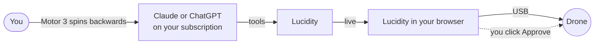
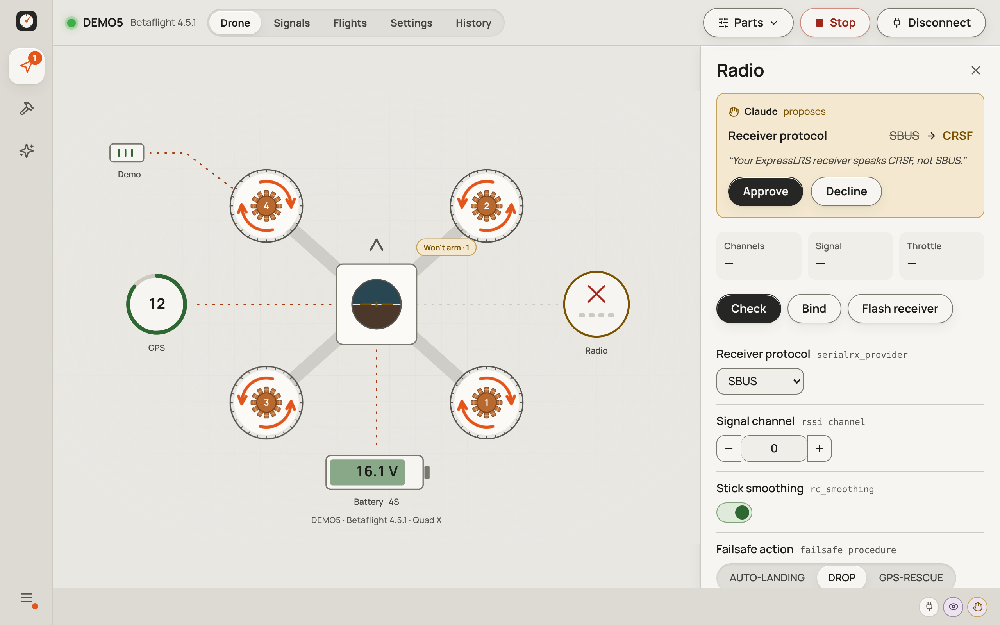

<div align="center">


# Lucidity

**Your drone. Your AI. One bench.**

Plug in your drone. Tell Claude or ChatGPT what’s wrong. Watch the fix happen.


</div>

## How it works



1. **Plug in.** Open Lucidity in Chrome or Edge and connect over USB. Nothing to install.
2. **Ask.** Add Lucidity to your assistant with one link. No API key.
3. **Approve.** The change appears on the part it affects. Nothing touches the drone until you click.



## What it can do

| | Betaflight · INAV | ArduPilot · PX4 |
| --- | --- | --- |
| Live readings | Attitude, battery, radio, motors, GPS, sensors, arming blocks | Same, plus vibration, EKF, status messages |
| Every setting | Console `dump`, ranges and allowed values; features, ports, modes | Full parameter list with readback |
| Tests | Health checks, motor spin, accelerometer and compass calibration | Same, plus level, gyro, barometer and arming checks |
| ESCs (BLHeli_S, Bluejay, AM32) | Read, change direction and settings, flash | Same, through ArduPilot passthrough |
| Firmware | Flight controller over DFU; ExpressLRS receivers | Flight controller over the bootloader (`.apj`) |
| Video and screen | VTX bands, channels and power presets; OSD layout editor | — |
| Backups | Snapshot, compare, restore | Snapshot and compare |
| Flight logs | Blackbox download, decode and analyse | Download and analyse |

**No drone yet? Build one.** The Build view is a parts sheet: choose what you want to fly, pick parts from a catalog or add your own, and see store links and prices for each. Every change shows compatibility checks, cost against budget, weight, thrust-to-weight and flight time. Swap any part for a ranked alternative, start from one of six proven builds, and compare builds side by side. An assistant open next to Lucidity can work on the same build through its tools.

Plus history of every change and test, standing permissions for small changes, offline use, shows (3D storyboards), startup sounds, and a demo drone for each stack. Everything an assistant does is recorded in Postgres tables you can query.

**The assistant gets eleven tools and one searchable map** of everything the connected aircraft offers: readings, tests, settings, guides and playbooks for common problems. It can read, test and propose. It cannot approve, confirm “props removed”, or arm.

## Run it

```sh
cd drone-studio
docker compose up --build        # Lucidity + Postgres on http://localhost:8787
```

Or for development:

```sh
npm ci
npm run build && npm run serve   # http://localhost:8787 (no DATABASE_URL: data stays in memory)
npm test                         # unit and integration tests
```

Assistants connect to `<your address>/mcp`. Set `PUBLIC_URL` to the address people use.

**On AWS:** Terraform in [`infra/aws`](infra/aws/README.md) sets up CloudFront, a load balancer, ECS Fargate and RDS Postgres, plus keyless deploys from GitHub. About $45 a month.

<details>
<summary>Status and limits</summary>

Every hardware path is tested against simulated flight controllers, ESCs and bootloaders that speak the real protocols. **Only the ArduPilot reads and ESC passthrough were first proven on a real aircraft; the new browser drivers, Betaflight, PX4, ESC writes, firmware and receiver flashing have not yet run on hardware.** Bench-test with props off before trusting a change. Mission upload and flight are not in the hosted app. See the [plan](drone-studio/docs/TOOL_APP_VISION.md), [design](drone-studio/docs/TOOL_APP_DESIGN.md), [architecture](drone-studio/docs/TOOL_APP_ARCHITECTURE.md) and [execution](drone-studio/docs/TOOL_APP_EXECUTION.md).

</details>

Apache 2.0 · [Security](SECURITY.md)
