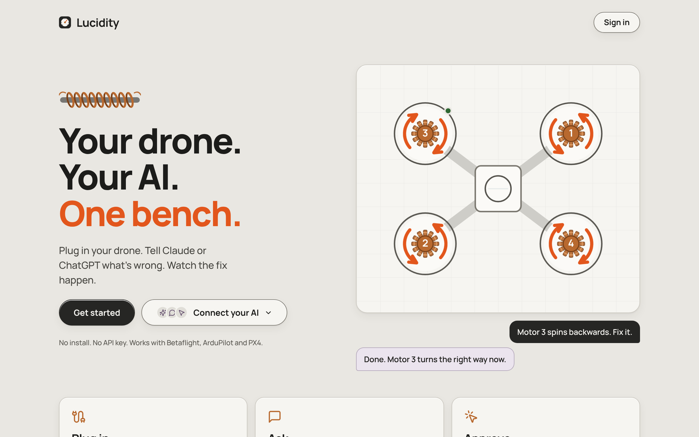
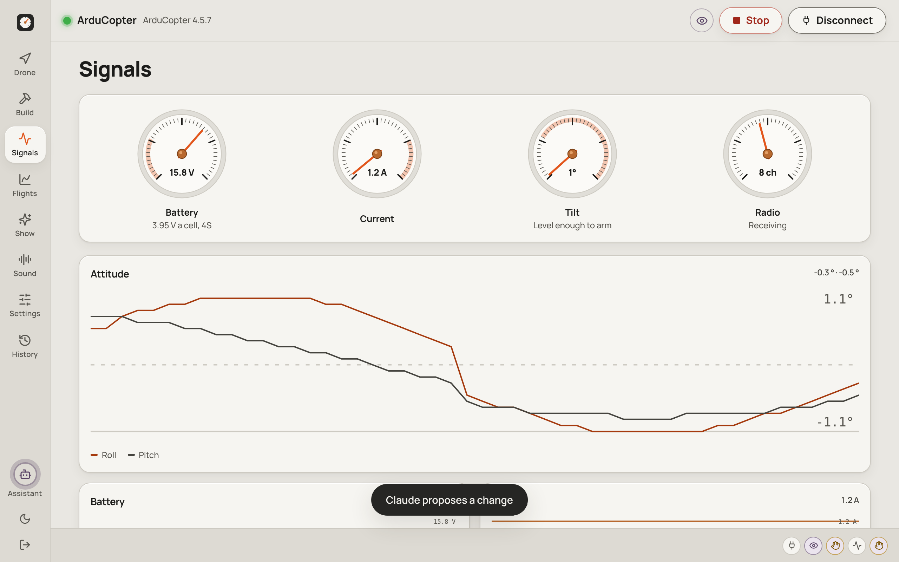
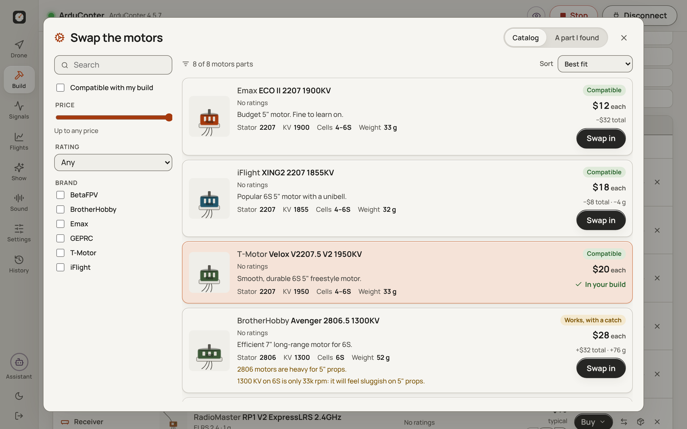

<div align="center">


# Lucidity

**The drone bench your AI can use.**

Plug in your drone. Ask Claude or ChatGPT. Approve the fix.



</div>

&nbsp;

## Say what’s wrong. See it fixed.

Lucidity runs in your browser and connects to your drone over USB. Your assistant connects to Lucidity with one link. It reads the drone, finds the cause and proposes a change on the part it affects. Nothing is written until you approve it, and every change is read back from the drone to confirm it.


1. **Plug in.** Chrome or Edge, a USB cable. Nothing to install.
2. **Connect your AI.** Claude, ChatGPT, Claude Code, Cursor, VS Code or any agent. No API key.
3. **Approve.** You make the call. The drone changes only when you click.

&nbsp;

## Every reading, at a glance.

Battery, current, attitude, radio, motors and sensors, live. The numbers that matter sit on dials. Everything else is a search away.



&nbsp;

## No drone yet? Build one.

Choose what you want to fly and your budget. Pick each part, or start from a proven build. Lucidity checks that the parts work together and shows the cost, take-off weight, thrust and flight time as you go.


Browse the catalog with filters for price, brand, rating and fit. Swap any part and see what it changes. Every part links to the stores that sell it. Rate the parts you’ve flown.



&nbsp;

## Works with what you fly.

| | Betaflight · INAV | ArduPilot · PX4 |
| --- | --- | --- |
| **Live readings** | Attitude, battery, radio, motors, GPS, sensors, arming blocks | Plus vibration, EKF and status messages |
| **Settings** | Every value, with ranges and readback | Every parameter, with readback |
| **Tests** | Health checks, motor spin, calibration | Plus level, gyro, barometer and arming checks |
| **ESCs** | BLHeli_S, Bluejay and AM32: read, configure, flash | Through ArduPilot passthrough |
| **Firmware** | Flight controller over DFU, ExpressLRS receivers | Flight controller over the bootloader |
| **Video** | VTX tables, OSD layout editor | — |
| **Backups** | Snapshot, compare, restore | Snapshot, compare |
| **Flight logs** | Blackbox download and analysis | Download and analysis |

Also: a history of every change and test, short-lived permissions for small changes, offline use, drone show storyboards, startup tunes, and a demo drone for each firmware.

&nbsp;

## You stay in control.

Your assistant can read, test and propose. It can’t approve a change, confirm that props are off, or arm the drone. Motor spins and firmware flashes are always started by you. Everything an assistant does is recorded.

&nbsp;

## Run it.

```sh
cd drone-studio
docker compose up --build        # Lucidity and Postgres at http://localhost:8787
```

For development:

```sh
npm ci
npm run build && npm run serve   # http://localhost:8787, data kept in memory
npm test
```

Assistants connect to `<your address>/mcp`. Set `PUBLIC_URL` to the address people use.

To host it on AWS, [`infra/aws`](infra/aws/README.md) sets up CloudFront, ECS Fargate and RDS Postgres with keyless deploys from GitHub, for about $45 a month.

<details>
<summary><b>Status</b></summary>

&nbsp;

Every hardware path is tested against simulated flight controllers, ESCs and bootloaders that speak the real protocols. ArduPilot reads and ESC passthrough have run on a real aircraft. The browser drivers, Betaflight, PX4, ESC writes, firmware and receiver flashing have not yet. Test on the bench with props off before you trust a change. Part prices in the build catalog are typical, not live.

More: [vision](drone-studio/docs/TOOL_APP_VISION.md) · [design](drone-studio/docs/DESIGN_SYSTEM.md) · [architecture](drone-studio/docs/TOOL_APP_ARCHITECTURE.md) · [execution](drone-studio/docs/TOOL_APP_EXECUTION.md)

</details>

&nbsp;

<div align="center">

Apache 2.0 · [Security](SECURITY.md)

</div>
