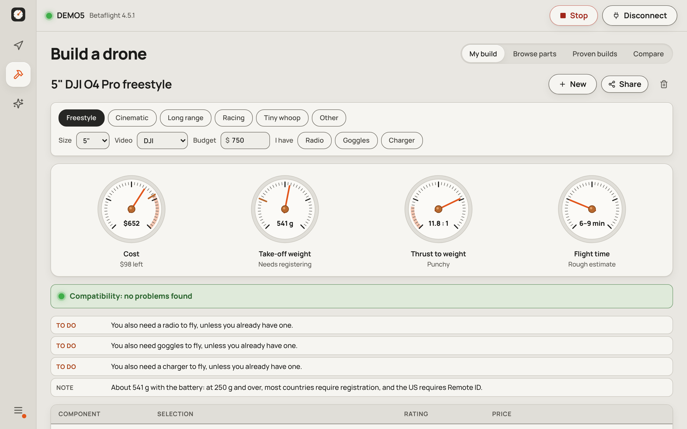

<div align="center">


# Lucidity

**Drone tools for your AI.**

Lucidity gives Claude, ChatGPT and other assistants the tools to read, test and fix your FPV drone.<br />It runs on the subscription you already have.

Free and open source · No sign-up · No install · No API key


</div>

&nbsp;

## Say what’s wrong. See it fixed.

Your assistant does the thinking. Lucidity does the hardware. It runs in your browser, connects to your drone over USB, and hands your assistant a set of tools: read every setting, run a check, propose a change. The change appears on the part it affects. Nothing is written until you approve it, and every change is read back from the drone to confirm it.

Above, a new quad won’t arm. It hears nothing from its receiver: the receiver speaks CRSF, the flight controller expects SBUS. One approval, and it arms. The demo drone has the same problem, so you can try it yourself.


1. **Plug in.** Chrome or Edge and a USB cable. Or open the demo drone.
2. **Connect your AI.** Add Lucidity as a connector in Claude, ChatGPT, Claude Code, Cursor or VS Code, with one link. Any other agent can set itself up from a skill file.
3. **Approve.** You make the call. The drone changes only when you click.

&nbsp;

## Your AI, your subscription.

Lucidity has no AI of its own and never asks for an API key. It works through the assistant you already use, on the plan you already pay for, with your history and preferences intact. Lucidity adds the parts an assistant can’t do alone: a USB connection to the drone, a map of everything the aircraft offers, and a screen where you see each step and approve it.

| | |
| --- | --- |
| **Claude** | Settings → Connectors → Add custom connector |
| **ChatGPT** | Settings → Connectors → Create |
| **Claude Code** | `claude mcp add --transport http lucidity <your address>/mcp` |
| **Cursor · VS Code** | One click from Lucidity’s menu |
| **Any agent** | Point it at `<your address>/agent-onboarding/SKILL.md` |

&nbsp;

## Every reading, at a glance.

Battery, current, attitude, radio, motors and sensors, live. The numbers that matter sit on dials. Everything else is a search away.


&nbsp;

## No drone yet? Build one.

Choose what you want to fly and your budget. Pick each part, or start from a proven build. Lucidity checks that the parts work together and shows the cost, take-off weight, thrust and flight time as you go.



Browse the catalog with filters for price, brand, rating and fit. Swap any part and see what it changes. Every part links to the stores that sell it. Rate the parts you’ve flown.


&nbsp;

## Works with what you fly.

| | Betaflight · INAV | ArduPilot · PX4 |
| --- | --- | --- |
| **Live readings** | Attitude, battery, radio, motors, GPS, sensors, arming blocks | Plus vibration, EKF and status messages |
| **Settings** | Every value, with ranges and readback | Every parameter, with readback |
| **Tests** | Health checks, motor spin, calibration | Plus level, gyro, barometer and arming checks |
| **ESCs** | BLHeli_S, Bluejay and AM32: read, configure, flash | Through ArduPilot passthrough |
| **Firmware** | Flight controller over DFU, ExpressLRS receivers | Flight controller over the bootloader |
| **Video** | VTX tables, OSD layout editor | — |
| **Backups** | Snapshot, compare, restore | Snapshot, compare |
| **Flight logs** | Blackbox download and analysis | Download and analysis |

Also: a history of every change and test, short-lived permissions for small changes, offline use, drone show storyboards, startup tunes, and a demo drone for each firmware.

&nbsp;

## You stay in control.

Your assistant can read, test and propose. It can’t approve a change, confirm that props are off, or arm the drone. Motor spins and firmware flashes are always started by you. Everything an assistant does is recorded, and you can switch it to read-only, or off, at any time.

&nbsp;

## Run it.

```sh
cd drone-studio
docker compose up --build        # Lucidity and Postgres at http://localhost:8787
```

For development:

```sh
npm ci
npm run build && npm run serve   # http://localhost:8787, data kept in memory
npm test
```

Assistants connect to `<your address>/mcp`, a standard [MCP](https://modelcontextprotocol.io) endpoint with sign-in.

| Setting | What it does |
| --- | --- |
| `PUBLIC_URL` | The address people use |
| `GOOGLE_CLIENT_ID`, `GOOGLE_CLIENT_SECRET` | Optional. Adds Continue with Google. The redirect address is `<your address>/auth/google/callback` |
| `FEEDBACK_WEBHOOK_URL` | Optional. Posts feedback to a Discord channel as it arrives |
| `ADMIN_EMAILS` | Optional. Who can read all feedback, with screenshots, at `/api/admin/feedback` |

Anyone can try Lucidity without an account. Guest benches nobody opens for 30 days are deleted. Links that open straight in: `/?demo=betaflight`, `/?demo=ardupilot` and `/build`. A shared build lives at `/b/<id>`.

To host it on AWS, [`infra/aws`](infra/aws/README.md) sets up CloudFront, ECS Fargate and RDS Postgres with keyless deploys from GitHub, for about $45 a month.

<details>
<summary><b>Status</b></summary>

&nbsp;

Every hardware path is tested against simulated flight controllers, ESCs and bootloaders that speak the real protocols. ArduPilot reads and ESC passthrough have run on a real aircraft. The browser drivers, Betaflight, PX4, ESC writes, firmware and receiver flashing have not yet. Test on the bench with props off before you trust a change. Part prices in the build catalog are typical, not live.

More: [vision](drone-studio/docs/TOOL_APP_VISION.md) · [design](drone-studio/docs/DESIGN_SYSTEM.md) · [architecture](drone-studio/docs/TOOL_APP_ARCHITECTURE.md) · [execution](drone-studio/docs/TOOL_APP_EXECUTION.md)

</details>

&nbsp;

<div align="center">

Apache 2.0 · [Security](SECURITY.md)

</div>
