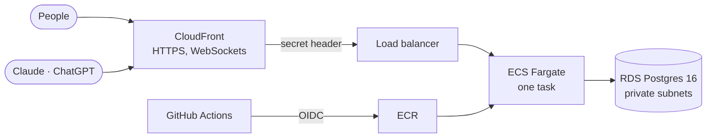

# Lucidity on AWS



| Piece | Choice |
| --- | --- |
| Address | CloudFront: `https://xxxx.cloudfront.net`, or your domain if you set one |
| App | One Fargate task (0.5 vCPU, 1 GB) behind a load balancer that only CloudFront can reach |
| Database | RDS Postgres 16, `db.t4g.micro`, encrypted, private, 7 days of backups, TLS verified |
| Secrets | Database password generated by Terraform, kept in SSM Parameter Store, never in the task definition |
| Deploys | GitHub Actions on `main`, signed in with OIDC, no stored AWS keys |

Rough cost at rest: about $45 a month in us-east-1 (load balancer ~$18, Fargate ~$18, database ~$13, CloudFront and logs a few dollars).

## First time

You need the AWS CLI signed in to the account, and Terraform 1.10 or newer.

```sh
# 1. A bucket for Terraform's state (once per account).
cd infra/aws/bootstrap
terraform init && terraform apply
terraform output -raw backend_hcl > ../backend.hcl

# 2. Everything else.
cd ..
cp terraform.tfvars.example terraform.tfvars      # optional: your domain
terraform init -backend-config=backend.hcl
terraform apply

# 3. Tell GitHub where to deploy.
gh variable set AWS_REGION          --body "$(terraform output -raw region)"
gh variable set AWS_DEPLOY_ROLE_ARN --body "$(terraform output -raw deploy_role_arn)"
gh variable set ECR_REPOSITORY_URL  --body "$(terraform output -raw ecr_repository_url)"
gh variable set ECS_CLUSTER         --body "$(terraform output -raw ecs_cluster)"
gh variable set ECS_SERVICE         --body "$(terraform output -raw ecs_service)"
gh variable set LUCIDITY_URL        --body "$(terraform output -raw url)"
```

4. Run **Deploy to AWS** from the Actions tab (or push to `main`). Until the first image is pushed, the service waits.
5. Open `terraform output url`. Add `terraform output mcp_url` as a connector in Claude or ChatGPT.

## Day to day

- **Deploy:** merge to `main`.
- **Logs:** `aws logs tail "$(terraform output -raw log_group)" --follow`
- **Custom domain later:** set `domain_name` and `route53_zone_id`, then `terraform apply`. Certificates and DNS are created for you, and CloudFront then talks to the load balancer over HTTPS too.
- **Tear down:** set `db_deletion_protection = false`, apply, then `terraform destroy`. A final database snapshot is kept.

## Why one task

Lucidity keeps live state in memory: which browser tab has the drone, and requests waiting on that tab. Two tasks would split an assistant from the tab it needs. So the service runs exactly one task, and a deploy has a gap of about a minute. Running more than one needs shared live state (for example Postgres `LISTEN/NOTIFY` or Redis); that is not built.

## Without a domain

Without your own domain, CloudFront reaches the load balancer over plain HTTP inside AWS's network edge. The load balancer accepts only CloudFront's address ranges and a secret header, but that hop is not encrypted. Set a domain to encrypt it end to end.
